# Supply Planning Engine

End-to-end synthetic **demand, inventory and supply planning** solution for the ORYVA AI student technical
assignment. One Python package generates a realistic, fully linked planning dataset (3,000 SKUs × 50
locations × 52 weeks at full scale), injects labelled edge cases, runs a weekly planning engine (quality gate →
projected available balance → MRP → production/BOM → shortages → mitigations → decisions), validates every
key, join and derived value, and evaluates itself against a separate ground-truth file.

Everything is deterministic: seed **20261022** gives byte-identical files on every run.

## Contents

1. [Overview](#1-overview)
2. [Architecture](#2-architecture)
3. [Quick start](#3-quick-start)
4. [Configuration and scales](#4-configuration-and-scales)
5. [Generator command and fixed seed](#5-generator-command-and-fixed-seed)
6. [Outputs map](#6-outputs-map)
7. [Planning logic summary](#7-planning-logic-summary)
8. [Edge cases and ground truth](#8-edge-cases-and-ground-truth)
9. [Validation results](#9-validation-results)
10. [Metrics](#10-metrics)
11. [Reproducibility](#11-reproducibility)
12. [Assumptions and limitations](#12-assumptions-and-limitations)
13. [Requirement → evidence checklist](#13-requirement--evidence-checklist)

## 1. Overview

The engine matches weekly forecast demand to on-hand and inbound inventory, supplier capacity, MOQs, lead
times and plant capacity (with BOMs), and then:

- **identifies** shortages: a contiguous run of weeks where the projected balance falls below safety stock;
- **explains** each one with rule-based causes that point at real evidence records (a PROMO demand row, a
  delayed PO, a capacity cut, a lead-time lane, an opening-stock record), plus a one-sentence explanation;
- **prioritises** them by value at risk × criticality × urgency;
- **mitigates** them: expedite, alternate supplier, transfer, substitute, extra production or backorder,
  each with cost, coverage, timeliness and a policy verdict, against a shared capacity ledger;
- **decides**: one recommendation per shortage, escalation to the operations manager above the approval
  threshold, all recorded as an append-only event history.

All data is synthetic. No external datasets are used (see [docs/source_manifest.md](docs/source_manifest.md)).

| | Starter | Full |
|---|---|---|
| SKUs / locations / weeks / suppliers / POs | 300 / 10 / 52 / 50 / 1,010 | 3,000 / 50 / 52 / 500 / 10,040 |
| Forecast rows | 89,544 | 966,524 |
| SKU-locations short | 11.71% | 11.87% |
| Shortages | 233 | 2,513 |
| Unexpected validation failures | **0** of 243 checks | **0** of 243 checks |
| Anomaly detection precision / recall | **1.0 / 1.0** (all 5 types) | **1.0 / 1.0** (all 5 types) |
| Same-seed reproducibility | 26/26 files identical | 26/26 files identical |

## 2. Architecture

```mermaid
flowchart LR
    CFG[/"config/*.yaml<br/>scale + seed 20261022"/] --> GEN

    subgraph GENERATE["python -m planner generate"]
        GEN["generate/<br/>1 master → 2 bridges → 3 supply<br/>→ 4 demand → 5 POs + events<br/>→ 6 ledger → inventory → 7 firm production"]
        INJ["inject/<br/>boundary cases + anomalies<br/>+ MANUAL substitute proposals"]
        GEN --> INJ
    end

    INJ --> DATA[("data/&lt;scale&gt;/csv<br/>input tables")]
    INJ --> GT[("ground_truth/&lt;scale&gt;/<br/>ground_truth.csv")]

    subgraph PLAN["python -m planner plan"]
        QG["quality_gate<br/>→ exception"] --> PAB["balance + replenish + production<br/>PAB, planned orders, BOM"]
        PAB --> SH["shortages<br/>causes, explanation, priority"]
        SH --> MIT["mitigations<br/>options + capacity ledger"]
        MIT --> DEC["decide<br/>policy, score, approval,<br/>recommendation, events"]
    end

    DATA --> QG
    DEC --> OUT[("data/&lt;scale&gt;/csv<br/>planner outputs")]

    OUT --> VAL["validate<br/>243 checks + SQLite FK load"]
    OUT --> EVA["evaluate<br/>metrics + precision/recall"]
    GT -. "read only here" .-> EVA
    OUT --> EXP["export<br/>JSON, seed.sql, manifest, profile"]
    VAL --> REP[("reports/")]
    EVA --> REP
    EXP --> REP
    REP --> RC["repro-check<br/>2 runs + seed+1, SHA-256"]
```



The planner (`plan/`) and the validator (`validate/`) never read `ground_truth/`; only `evaluate.py` does,
and only `inject/` writes it. `tests/test_plan.py::test_plan_and_validate_never_reference_ground_truth` and
`tests/test_inject_evaluate.py::test_ground_truth_isolation` enforce this.

Code layout (`src/planner/`):

| Module | Role |
|---|---|
| `__main__.py` | CLI (8 commands) |
| `config.py`, `ids.py`, `rng.py`, `calendar.py` | config loading, ID formatters + regexes, named RNG streams, ISO weeks |
| `schema.py` | single source of truth for all 26 tables (25 data tables + ground truth) (fields, types, enums, units, PK, FKs, rules, lifecycles) |
| `generate/` | `master`, `bridges`, `supply`, `demand`, `orders`, `inventory`, `production` (Section 9 steps 1–7) |
| `inject/` | `boundaries`, `anomalies` (step 8; the only writer of `ground_truth/`) |
| `plan/` | `quality_gate`, `balance`, `replenish`, `production`, `shortages`, `mitigations`, `decide` |
| `validate/` | `checks` (schema + input domain), `plan_checks` (planner outputs), `report` |
| `evaluate.py` | metrics and detection scores (the only reader of `ground_truth/`) |
| `export.py`, `sqlio.py`, `manifest.py`, `profile.py`, `repro.py`, `docs_gen.py` | exports, SQLite, manifest, data profile, reproducibility, generated docs |

## 3. Quick start

Requires Python 3.11 or newer and git. Copy and paste:

```bash
git clone https://github.com/brvivek62-debug/supply-planning-engine.git
cd supply-planning-engine
python3 -m venv .venv
source .venv/bin/activate            # Windows: .venv\Scripts\activate
pip install -e .
python -m planner run-all --scale starter
```

`run-all` runs generate → plan → validate → evaluate → export → repro-check with seed 20261022. It takes about
a minute at starter scale, rewrites `data/starter/`, `ground_truth/starter/` and `reports/`
byte-for-byte identically to the committed files (check with `git status`), and exits non-zero if any
unexpected validation failure or checksum mismatch occurs.

Run the tests (they use the small `test` scale, a few seconds):

```bash
pip install -e ".[dev]"
python -m pytest
```

Full scale (about 5 minutes on an Apple M4):

```bash
python -m planner run-all --scale full
```

## 4. Configuration and scales

Each scale is one YAML file in `config/`. The files are identical except for `volumes`, `injection` and
the output format, so starter and full use exactly the same generator code.

| Parameter | `test` (pytest) | `starter` | `full` |
|---|---|---|---|
| SKUs | 60 | 300 | **3,000** |
| Locations (PLANT / DC / STORE) | 6 (1/2/3) | 10 (2/3/5) | **50** (5/10/35) |
| Weeks | 52 | 52 | **52** |
| Suppliers | 15 | 50 | **500** |
| Purchase orders (baseline) | 200 | 1,000 | **10,000** |
| Anomalies per issue type | 3 | 10 | 40 |
| Boundary cases per type | 2 | 5 | 15 |
| Output | csv | csv + json + seed.sql | csv.gz |

Shared parameters (all in the YAML, documented inline): as-of date **2025-12-29** (start of 2026W01),
history window, ABC shares (20/30/50%), promo rate 3% at 2–4×, seasonality amplitude, negative-binomial
dispersion, supplier headroom 1.15–1.3, disruption share 10% (4–8 weeks at 0.5–0.7×), lead-time change
share 5% from W27, substitute share 15% (70% approved), PO received 20% / cancelled 4% / delay rate 8%
(1–3 weeks), opening cover, firm production weeks (4), build-ahead (1 week), policy thresholds (approval
above ₹2,00,000 or 25% of value at risk, transfer lead 1/2 weeks), cost parameters (AIR premium, freight,
transfer, overtime, backorder penalty, all INR) and score weights (coverage 0.6, timeliness 0.25, cost 0.15).

To try a variant, copy a YAML file, edit it, and pass the same scale name, or override the seed:

```bash
python -m planner run-all --scale starter --seed 12345
```

## 5. Generator command and fixed seed

```bash
python -m planner generate    --scale starter --seed 20261022   # baseline + injected cases + ground truth
python -m planner plan        --scale starter                   # quality gate, PAB, shortages, mitigations, decisions
python -m planner validate    --scale starter                   # all checks -> reports/validation_summary.{md,json}
python -m planner evaluate    --scale starter                   # metrics + detection precision/recall vs ground truth
python -m planner export      --scale starter                   # CSV/JSON/SQL + manifest + checksums + data profile
python -m planner repro-check --scale starter --seed 20261022   # run twice in temp dirs, compare rows + SHA-256
python -m planner docs                                          # data dictionary, schema.sql, ERD from schema.py
python -m planner run-all     --scale starter --seed 20261022   # all of the above in order (except docs)
```

- `--scale` is `test`, `starter` (default) or `full`; `--seed` defaults to **20261022**.
- One `numpy.random.SeedSequence(seed)`; each table draws from a child stream keyed by the SHA-256 of a
  fixed stream name, so adding a stream never shifts another table's numbers.
- No wall-clock time, UUIDs or run timestamps in data files (timing lives only in the git-ignored
  `run_info.json`); rows sorted by primary key, fixed rounding, `\n` line endings, gzip `mtime=0`.

## 6. Outputs map

| Path | What | Written by |
|---|---|---|
| `data/starter/csv/*.csv` | 25 tables: 17 inputs + 8 planner outputs | `generate`, `plan` |
| `data/starter/json/*.json` | the same tables as JSON | `export` |
| `data/starter/sql/seed.sql` | INSERTs in FK order (loads into `sql/schema.sql`) | `export` |
| `data/full/csv/*.csv.gz` | full-scale tables (largest committed file is 20.7 MB; nothing is over 50 MB) | `generate`, `plan` |
| `data/<scale>/manifest.json` | every file with rows, bytes, SHA-256, command, seed, scale, version | `export` |
| `ground_truth/<scale>/ground_truth.csv` | labelled anomalies and boundary cases | `generate` (inject step) |
| `sql/schema.sql` | SQLite DDL with PK, FK, UNIQUE and CHECK constraints | `docs` |
| `docs/data_dictionary.md` | every field: type, required, allowed values, unit, unique, rule | `docs` |
| `docs/erd.md` | Mermaid ERD, cardinality (1:1 / 1:N / N:M, optional), effective dates, lifecycle state machines | `docs` |
| `docs/business_rules.md` | 49 numbered rules, each mapped to its owning actor, code and check | hand-written |
| `docs/source_manifest.md` | provenance statement + checksums for both scales | `export` |
| `docs/decisions.md` | every design decision, one line each, with the reason | hand-written |
| `reports/validation_summary.{md,json}` | one row per check (starter); full in `reports/full/` | `validate` |
| `reports/metrics.{md,json}` | planning, recovery, mitigation and detection metrics | `evaluate` |
| `reports/data_profile.md`, `reports/figures/*.png` | ABC share, CV, promo lift, seasonality, lead times, capacity use, delays, PO status | `export` |
| `reports/reproducibility.{md,json}` | file → rows → SHA-256 for two runs and seed + 1 | `repro-check` |
| `reports/test_results.txt` | `pytest` output | `pytest -q \| tee` |

Tables (`schema.py`): masters `location`, `sku`, `supplier`; bridges `sku_location`, `supplier_sku`,
`sku_substitute`, `bom`; supply/demand `lead_time`, `supplier_capacity`, `production_capacity`,
`forecast_demand`; transactions/events `purchase_order`, `purchase_order_event`, `inventory_txn`,
`inventory`, `production_plan`, `mitigation_proposal`; planner outputs `exception`, `planned_order`,
`projected_balance`, `shortage`, `shortage_cause`, `mitigation_option`, `mitigation_ledger`,
`shortage_event`.

## 7. Planning logic summary

The full numbered rule list with owners is in [docs/business_rules.md](docs/business_rules.md).

1. **Quality gate** (`plan/quality_gate.py`) scans inputs before planning and writes `exception` rows:
   UOM_MISMATCH → CORRECTED, LEAD_TIME_IGNORED → CORRECTED, DUPLICATE_INBOUND → EXCLUDED,
   SUPPLIER_CAPACITY_EXCEEDED → CAPPED (overflow pushed to the next week with spare capacity). The
   fifth type, UNAPPROVED_SUBSTITUTE, is caught in `decide` and FLAGGED.
2. **Projected available balance** (`plan/balance.py`), backlog semantics, integer EA:
   opening(W01) = ON_HAND; closing = opening + firm receipts + planned receipts + production receipts −
   demand; opening(w) = closing(w−1).
3. **MRP** (`plan/replenish.py`): below safety stock → planned order for the SS gap + 4 weeks of demand,
   rounded up to MOQ / multiple in purchase UoM, on the primary supplier's lane version effective at
   release. Release before W01 is impossible (lead-time fence). Supplier capacity is allocated per receipt
   week in priority order (criticality, ABC, sku_id), with up to 8 weeks of pre-build; the remainder is
   `capacity_cut_ea`.
4. **Production and BOM** (`plan/production.py`): PLANNED production covers net requirements within plant
   capacity (+1 week build-ahead); component demand = production × qty_per; a short component cuts the
   parent proportionally (COMPONENT_SHORTAGE).
5. **Shortages** (`plan/shortages.py`): run of weeks below SS; STOCKOUT if closing < 0, else
   BELOW_SAFETY_STOCK. Causes: DEMAND_SPIKE, PO_DELAYED, SUPPLIER_CAPACITY, LEAD_TIME_FENCE,
   LOW_OPENING_STOCK, COMPONENT_SHORTAGE, PRODUCTION_CAPACITY, each with an evidence ID in
   `shortage_cause`. priority = VaR × criticality (3/2/1) × 1/√(1 + weeks to start).
6. **Mitigations** (`plan/mitigations.py`), in priority order against one capacity ledger (supplier
   capacity, plant capacity, stock): EXPEDITE_PO (AIR lane), ALTERNATE_SUPPLIER, TRANSFER (source stays
   ≥ SS), SUBSTITUTE_SKU, INCREASE_PRODUCTION, BACKORDER. Each option has coverage, weeks late, cost,
   fill rate after, score and policy status.
7. **Decide** (`plan/decide.py`): score = 0.6 coverage + 0.25 timeliness − 0.15 normalised cost;
   requires_approval above ₹2,00,000 or 25% of VaR; recommend the best COMPLIANT non-backorder option,
   never a VIOLATION, else BACKORDER. Events: OPEN → MITIGATION_PROPOSED → MITIGATION_SELECTED /
   ESCALATED / BACKORDER_ACCEPTED.

Example explanation (starter, rank 2):
> Stockout of 124 EA for SKU-000253 at LOC-008 in 2026W06–W08 (low point -124 EA in 2026W08, safety stock
> 34 EA): SUP-0016 had no spare capacity for this SKU in 2026W06–W08 (3 wk); unmet requirement reached
> 360 EA by 2026W08 (CAP-0000788); SEASONAL_PEAK demand +148% vs baseline in 2026W06
> (DEM-SKU-000253-LOC-008-2026W06).

## 8. Edge cases and ground truth

The generator builds a valid baseline first and then injects cases, touching only the targeted records
(`tests/test_inject_evaluate.py::test_injection_touches_only_targeted_records`).

| issue_type (brief §6) | Injection | Detection → action |
|---|---|---|
| DUPLICATE_INBOUND — inbound counted twice | second IN_TRANSIT `inventory` row for an open shipped PO | > 1 IN_TRANSIT row per PO → EXCLUDED |
| UNAPPROVED_SUBSTITUTE — substitute not approved | MANUAL `mitigation_proposal` by PLANNER using a PENDING / REJECTED / unruled substitute for a real shortage | VIOLATION, never recommended → FLAGGED |
| SUPPLIER_CAPACITY_EXCEEDED | extra firm PO (new ID `PO-2026-001001`…) overloading a supplier-week | load > capacity → CAPPED |
| LEAD_TIME_IGNORED — shortage calculated without lead time | receipt week set to the order week | receipt < order + lead → CORRECTED; the corrected plan shows the shortage the naive plan missed |
| UOM_MISMATCH | CASE PO with qty_base_ea = order_qty | qty_base ≠ qty × conversion → CORRECTED |

Boundary cases that must **not** raise exceptions: PO qty exactly at MOQ, supplier-week load exactly at
capacity, receipt exactly at order week + lead time.

`ground_truth/<scale>/ground_truth.csv` columns: `gt_id, case_class, issue_type, entity, record_id,
related_record_ids, injection_rule, expected_detection_rule, expected_action, expected_outcome`. Starter has
65 labels (50 anomalies + 15 boundary), full has 245 (200 + 45). Each label names the source record and
its related records, so a case can be traced to the `exception` row that caught it.

## 9. Validation results

`python -m planner validate` runs 243 checks: PK uniqueness, required fields, enums, ID regexes, value
bounds, FK integrity (incl. composite FKs and polymorphic evidence IDs), natural-key duplicates, effective
dates, event ordering, no events after as-of, lifecycle transitions, status = last event, ledger and PAB
reconciliation, PO arithmetic, capacity, shortage and cause evidence, mitigation policy and capacity
ledger, plus a SQLite load with `PRAGMA foreign_keys=ON` and `PRAGMA foreign_key_check`.

| Scale | Checks | PASS | EXPECTED_FAIL | FAIL | Rows checked | **Unexpected failures** |
|---|---|---|---|---|---|---|
| starter | 243 | 239 | 4 (44 records) | 0 | 2,473,778 | **0** |
| full | 243 | 239 | 4 (188 records) | 0 | 26,599,972 | **0** |

The 4 expected failures are the raw-input checks broken by the injected anomalies
(`po_qty_uom_moq`, `po_receipt_week_arithmetic`, `firm_po_within_supplier_capacity`,
`in_transit_mirrors_open_pos`). A failure counts as expected only when the planner's own `exception` table
names that record under the issue type that explains it; validation never reads the ground truth. Details:
[reports/validation_summary.md](reports/validation_summary.md), [reports/full/validation_summary.md](reports/full/validation_summary.md).

Tests: **140 passed** ([reports/test_results.txt](reports/test_results.txt)).

## 10. Metrics

From [reports/metrics.md](reports/metrics.md) and [reports/full/metrics.md](reports/full/metrics.md):

| Metric | Starter | Full |
|---|---|---|
| Total demand (finished SKUs, 52 weeks) | 9,376,097 EA | 73,279,054 EA |
| SKU-locations with ≥ 1 shortage | 208 of 1,777 (11.71%) | 2,288 of 19,274 (11.87%) |
| Shortages (STOCKOUT / BELOW_SAFETY_STOCK) | 233 (66 / 167) | 2,513 (1,103 / 1,410) |
| Top primary causes | SUPPLIER_CAPACITY 79, LEAD_TIME_FENCE 47, DEMAND_SPIKE 45 | SUPPLIER_CAPACITY 1,287, LEAD_TIME_FENCE 481, DEMAND_SPIKE 362 |
| Fill rate before → after recommended mitigations | 99.9839% → 99.9926% | 99.7015% → 99.7502% |
| Fill rate, short SKU-locations only | 99.72% → 99.87% | 96.16% → 96.79% |
| Mitigation options (VIOLATION alternatives) | 973 (39) | 11,045 (440) |
| Recommended mix | TRANSFER 122, BACKORDER 47, INCREASE_PRODUCTION 42, ALT_SUPPLIER 11, SUBSTITUTE 6, EXPEDITE 5 | TRANSFER 1,483, BACKORDER 675, ALT_SUPPLIER 252, INCREASE_PRODUCTION 53, SUBSTITUTE 30, EXPEDITE 20 |
| COMPLIANT non-backorder recommendation | 79.83% | 73.14% |
| Fully covered | 59.66% | 48.15% |
| Total mitigation cost (per covered EA) | ₹244,068.55 (₹37.12) | ₹5,528,459.72 (₹15.72) |
| Value at risk recovered | ₹404,460 (86.2%) | ₹10,860,136 (15.0%) |
| Escalated to operations manager | 25 | 180 |
| Recommended VIOLATION options | **0** | **0** |
| Detection precision / recall / F1 (each of 5 types) | 1.0 / 1.0 / 1.0 | 1.0 / 1.0 / 1.0 |
| Boundary false positives | **0** of 15 | **0** of 45 |

Data realism ([reports/data_profile.md](reports/data_profile.md)): A-class = 20% of SKUs and 78.4% of
demand; weekly CV median 0.57 (p10 0.44, p90 0.79); PROMO 2.96% of weeks, median lift 2.67×; SEA lanes
5–9 weeks, ROAD 1–3, RAIL 2–4, AIR 1–2; transport delay rate 8.25%; PO status RECEIVED 19.8%, CANCELLED
4.0%, rest open.

## 11. Reproducibility

```bash
python -m planner repro-check --scale starter --seed 20261022
```

runs `generate` + `plan` twice with the same seed into fresh temporary folders and once with seed + 1, then
compares row counts and SHA-256 of every CSV and the ground truth.

| Scale | Same seed | Seed 20261023 |
|---|---|---|
| starter | 26 / 26 files byte-identical | 26 / 26 files differ |
| full | 26 / 26 files byte-identical | 26 / 26 files differ |

Per-file table: [reports/reproducibility.md](reports/reproducibility.md) and
[reports/full/reproducibility.md](reports/full/reproducibility.md). Committed checksums are in
`data/<scale>/manifest.json` and [docs/source_manifest.md](docs/source_manifest.md), so a fresh
`run-all` can be compared with `git status` (no changes expected).

## 12. Assumptions and limitations

Every decision and its reason is logged in [docs/decisions.md](docs/decisions.md). The main ones:

- **Weeks and dates:** ISO weeks of 2026; as-of date 2025-12-29 (start of 2026W01). PO order dates run
  2025-09-01 to 2025-12-28, not into 2026-04, because no event may be dated after the as-of date.
- **Volumes:** full scale has 966,524 forecast rows, not ~1.2M: the specified 6–10 locations per BUY
  finished SKU gives that number, and the assortment rule was kept rather than inflated. Injected POs bring
  the PO count to 10,040 (10,000 baseline + 40).
- **Supplier headroom 1.15–1.3**, above the 1.0–1.15 first suggested: at ~1.08× demand there is no slack to
  rebuild safety stock and 25–30% of SKU-locations stayed short all year. Constraints come from temporary
  disruptions (10% of suppliers, 4–8 weeks at 0.5–0.7×), not a stored flag.
- **Backlog semantics** in the PAB; fill rate is period fill rate under backlog. The overall fill rate is
  high because most SKU-locations are never short; the short-only fill rate shows the mitigation effect.
- **One recommendation per shortage**; combinations (e.g. two transfers) are not proposed, so partial
  coverage is reported as `coverage_pct` < 100%.
- **Full-scale recovery is lower** (26% of shortage units, 15% of value at risk, vs 52% / 86% at starter):
  most full-scale value at risk sits in W01–W03 shortages inside the lead-time fence or at capacity-bound
  suppliers that no option can reach in time; these end as BACKORDER_ACCEPTED.
- **Approvals:** `ESCALATED` hands a shortage to the operations manager; the approval decision itself happens
  after the planning run and is not simulated, so no `OPERATIONS_MANAGER` event rows exist yet.
- **Cause code PRODUCTION_CAPACITY** was added to the six in the brief, because MAKE shortages caused by plant
  capacity had no honest code otherwise.
- **SKU lifecycle and supplier status** are effective-dated snapshot states; PO and shortage lifecycles have
  full append-only event tables.
- At starter scale the 5 PO_QTY_EQUALS_MOQ boundary picks are POs already at MOQ (label-only; stated in the
  label's `injection_rule`).
- Full-scale JSON and `seed.sql` are not exported (they would exceed GitHub's 50 MB limit); full ships
  `csv.gz` plus its manifest.

## 13. Requirement → evidence checklist

Every requirement in the assignment PDF, sections 1–10, with the file that proves it.

### §1 Problem statement

| Requirement | Evidence |
|---|---|
| Match forecast demand to inventory, supplier capacity, lead times and production constraints | `src/planner/plan/balance.py`, `replenish.py`, `production.py`; `data/starter/csv/projected_balance.csv`, `planned_order.csv`, `production_plan.csv` |
| Shortages identified | `data/starter/csv/shortage.csv` (233 rows); `src/planner/plan/shortages.py` |
| Shortages explained | `shortage.csv` (`explanation`, `primary_cause`), `data/starter/csv/shortage_cause.csv`; check `every_shortage_explained` in `reports/validation_summary.md` |
| Shortages prioritised | `shortage.csv` (`priority_score`, `priority_rank`); top 20 in `reports/metrics.md` |

### §2 Objective and scope

| Requirement | Evidence |
|---|---|
| Working solution for the complete workflow | `python -m planner run-all`; `src/planner/__main__.py` |
| Expose key decisions | `data/starter/csv/mitigation_option.csv` (`is_recommended`, `requires_approval`, `policy_status`), `shortage_event.csv` |
| Expose exceptions (at least one exception path) | `data/starter/csv/exception.csv`; `src/planner/plan/quality_gate.py` |
| Preserve traceability | `shortage_cause.evidence_id`, `exception.related_record_ids`, `ground_truth.related_record_ids`; check `cause_evidence_resolves` |
| Measurable outputs and evaluation metrics | `reports/metrics.md`, `reports/metrics.json` |
| Multiple related entities, conditional business rules | `src/planner/schema.py` (26 tables); `docs/business_rules.md` (49 rules) |
| Actors: Supplier, Planner, Carrier / warehouse operator, Logistics analyst, Operations manager | `docs/business_rules.md` (owner per rule); `purchase_order_event.actor_role`, `shortage_event.actor_role` |

### §3 Business workflow and rules

| Requirement | Evidence |
|---|---|
| Master data first (SKU, Location, ForecastDemand, Inventory, Supplier) | `src/planner/generate/__init__.py` (step order); `tests/test_generate.py::test_generation_order_respects_foreign_keys` |
| Dependent records use valid parent IDs | FK checks + `sqlite_fk_check` in `reports/validation_summary.md`; `data/starter/sql/seed.sql` loads with FKs on |
| Weekly SKU-location demand | `data/starter/csv/forecast_demand.csv` |
| Seed on-hand and inbound inventory | `inventory.csv` (ON_HAND, IN_TRANSIT), `inventory_txn.csv`, `purchase_order.csv` |
| Supplier capacity, minimum quantities, lead times | `supplier_capacity.csv`, `supplier_sku.csv` (`moq`, `order_multiple`), `lead_time.csv` |
| Production capacity and BOM requirements | `production_capacity.csv`, `bom.csv`, `production_plan.csv` |
| Projected available balance | `projected_balance.csv`; check `pab_reconciles` |
| Shortages and candidate mitigations | `shortage.csv`, `mitigation_option.csv` |
| Preserve history, never overwrite | `purchase_order_event.csv`, `shortage_event.csv`, `inventory_txn.csv` (append-only); checks `status_equals_last_event`, `shortage_lifecycle` |
| Outcomes and labels derived from documented rules | `docs/business_rules.md`; `src/planner/inject/` (labels written from the injection rule); `docs/decisions.md` |

### §4 Entities, relationships and traceability

| Requirement | Evidence |
|---|---|
| 11 core entities (SKU, Location, ForecastDemand, Inventory, Supplier, SupplierCapacity, LeadTime, PurchaseOrder, ProductionPlan, Shortage, MitigationOption) | `src/planner/schema.py`; `tests/test_schema.py::test_core_entities_present`; `docs/data_dictionary.md` |
| PK for every entity, FK for every relationship | `sql/schema.sql`; `docs/data_dictionary.md`; `tests/test_schema.py::test_foreign_keys_resolve_to_earlier_unique_keys` |
| Cardinality 1:1 / 1:N / N:M, optional relationships | `docs/erd.md` § Cardinality |
| Effective dates and lifecycle states | `docs/erd.md` § Effective-dated entities, § Lifecycle state machines |
| Bridge tables for N:M | `sku_location`, `supplier_sku`, `sku_substitute`, `bom`, `shortage_cause`; `tests/test_schema.py::test_bridge_tables_cover_many_to_many` |
| Event history kept; all joins validated | `purchase_order_event.csv`, `shortage_event.csv`; FK checks in `reports/validation_summary.md` |
| Anomalies stored with an issue_type / ground-truth label, unrelated rows untouched | `ground_truth/starter/ground_truth.csv`, `exception.csv`; `tests/test_inject_evaluate.py::test_injection_touches_only_targeted_records` |
| ID patterns SKU-000001, DEM-…-2026W01, PO-2026-000001, SHORT-2026-000001, MIT-…-01; zero-padded, immutable, consistent | `src/planner/ids.py`; `tests/test_ids.py`; `id_format` checks + FK checks in `reports/validation_summary.md` |

### §5 Synthetic data generation steps

| Step | Evidence |
|---|---|
| 1 Data dictionary (type, required, allowed values, units, uniqueness, rule) | `docs/data_dictionary.md`; `tests/test_schema.py::test_table_definition_is_complete` |
| 2 Generate in dependency order | `src/planner/generate/__init__.py`; `tests/test_generate.py::test_generation_order_respects_foreign_keys` |
| 3 Deterministic IDs | `src/planner/ids.py`; `id_format` checks |
| 4 Volumes 3,000 / 50 / 52 / 500 / 10,000 | `config/full.yaml`; `data/full/manifest.json`; `reports/full/metrics.md`; `tests/test_calendar_rng_config.py::test_full_scale_volumes_match_brief` |
| 4 Demand spikes, constrained suppliers, substitutes, transport delays | `reports/data_profile.md` (PROMO 2.96%, utilisation, delay rate 8.25%); `sku_substitute.csv`; causes DEMAND_SPIKE / SUPPLIER_CAPACITY / PO_DELAYED in `reports/metrics.md` |
| 4 Fixed seed 20261022, parameterised scale, same generator | `config/*.yaml`; `src/planner/__main__.py` (`DEFAULT_SEED`); `data/<scale>/manifest.json` |
| 5 Valid baseline first, then labelled edge cases | `src/planner/inject/`; `tests/test_inject_evaluate.py::test_injected_inputs_fail_only_expected_domain_checks` |
| 6 Derived values computed from source records | checks `on_hand_equals_ledger`, `pab_reconciles`, `shortages_match_pab`, `safety_stock_derived`, `mitigation_coverage_recomputes` |
| 7 Separate ground truth, never an input feature | `ground_truth/starter/ground_truth.csv`, `ground_truth/full/ground_truth.csv`; `tests/test_inject_evaluate.py::test_ground_truth_isolation` |
| 8 PK, FK, enum, date-ordering, arithmetic, lifecycle and duplicate checks | `reports/validation_summary.md` (+ `.json`), `reports/full/validation_summary.md` |
| 9 CSV / JSON / SQL exports | `data/starter/csv/`, `data/starter/json/`, `data/starter/sql/seed.sql`, `data/full/csv/*.csv.gz` |
| 9 README, schema / data dictionary, generator command, fixed seed, source manifest, validation summary | this README; `sql/schema.sql`, `docs/data_dictionary.md`; §5 above; `docs/source_manifest.md`; `reports/validation_summary.md` |
| 10 Regenerate twice, compare row counts and checksums | `reports/reproducibility.md`, `reports/full/reproducibility.md`; `tests/test_generate.py::test_same_seed_identical_bytes_different_seed_differs` |

### §6 Required edge cases

| Edge case | Label and trace |
|---|---|
| Inbound inventory counted twice | `DUPLICATE_INBOUND` in `ground_truth/starter/ground_truth.csv` → `exception.csv` (EXCLUDED); recall 1.0 in `reports/metrics.md` |
| Substitute SKU not approved | `UNAPPROVED_SUBSTITUTE` → `mitigation_option.csv` (VIOLATION) + `exception.csv` (FLAGGED) |
| Supplier capacity exceeded | `SUPPLIER_CAPACITY_EXCEEDED` → `exception.csv` (CAPPED) |
| Shortage calculated without lead time | `LEAD_TIME_IGNORED` → `exception.csv` (CORRECTED); expected shortage verified in `reports/metrics.md` |
| Units-of-measure mismatch | `UOM_MISMATCH` → `exception.csv` (CORRECTED) |
| Each case identifiable and traceable to source records | `ground_truth.csv` (`record_id`, `related_record_ids`); `tests/test_inject_evaluate.py::test_every_anomaly_detected_with_exact_precision` |

### §7 Validation rules and acceptance criteria

| Criterion | Evidence |
|---|---|
| PAB reconciles week by week | check `pab_reconciles`, `pab_inputs_tie_out`; `tests/test_plan.py::test_pab_reconciles_week_by_week`, `test_pab_independent_recompute` |
| Every shortage has explainable causes | checks `every_shortage_explained`, `cause_evidence_resolves`, `explanation_names_ids`; `tests/test_plan.py::test_every_shortage_has_resolvable_cause` |
| Every mitigation respects policy and available capacity | checks `mitigation_policy`, `mitigation_capacity_ledger`; `tests/test_mitigations.py::test_no_recommended_violation`, `test_capacity_ledger_never_negative_after_mitigation` |
| Alternatives show cost and service trade-offs | `mitigation_option.csv` (cost, coverage, weeks late, fill rate after, score per option); `tests/test_mitigations.py::test_alternatives_show_cost_vs_service` |
| PKs unique, all FK joins valid | `pk` / `fk` checks and `sqlite_fk_check` in `reports/validation_summary.md` |
| Derived values reconcile; lifecycle transitions and dates valid | `on_hand_equals_ledger`, `po_qty_uom_moq`, `lifecycle_transitions`, `event_ts_increasing`, `effective_date_order`, `no_event_after_as_of` |

### §8 Evaluation focus

| Area | Evidence |
|---|---|
| A Realistic distributions, variation | `reports/data_profile.md`, `reports/figures/*.png`; `tests/test_generate.py::test_realistic_variation` |
| B Consistent IDs, valid joins | `id_format`, `fk`, `sqlite_fk_check` in `reports/validation_summary.md` |
| C Dependency and lifecycle consistency | `docs/erd.md`; `lifecycle_transitions`, `status_equals_last_event`, `shortage_lifecycle` |
| D Correct derived values, reconciliation | `pab_reconciles`, `on_hand_equals_ledger`, `shortages_match_pab`, `mitigation_coverage_recomputes` |
| E Normal, boundary, failure, exception coverage | `ground_truth/starter/ground_truth.csv` (50 anomalies, 15 boundary); `exception.csv`; boundary FP = 0 in `reports/metrics.md` |
| F Separate ground truth, excluded from features | `ground_truth/`; `tests/test_inject_evaluate.py::test_ground_truth_isolation`, `tests/test_plan.py::test_plan_and_validate_never_reference_ground_truth` |
| G Reproducibility, documentation, lawful provenance | `reports/reproducibility.md`; this README, `docs/`; `docs/source_manifest.md`; `LICENSE` |

### §9 Public data and lawful use

| Requirement | Evidence |
|---|---|
| External data optional; if used, record source, license, transformations | Not used: all data is synthetic. Statement in `docs/source_manifest.md` and `data/<scale>/manifest.json` (`provenance`) |
| No confidential or personal information | Synthetic names and IDs only (`src/planner/generate/master.py`); Indian city names are public knowledge, used for realism |

### §10 Submission requirements

| Requirement | Evidence |
|---|---|
| Public GitHub repository | https://github.com/brvivek62-debug/supply-planning-engine |
| README: install, configure, run | this file, §3–§5 |
| Tests and validation output | `tests/`, `reports/test_results.txt`; `reports/validation_summary.md`, `reports/full/validation_summary.md` |
| Generated data exports | `data/starter/{csv,json,sql}/`, `data/full/csv/` |
| Schema / data dictionary | `sql/schema.sql`, `docs/data_dictionary.md`, `docs/erd.md` |
| Generator command and fixed seed | §5 above; `data/<scale>/manifest.json` (`generator_command`, `seed`) |
| Source manifest | `docs/source_manifest.md`, `data/<scale>/manifest.json` |
| Validation summary | `reports/validation_summary.md` |
| Separate ground-truth file | `ground_truth/starter/ground_truth.csv`, `ground_truth/full/ground_truth.csv` |
| Reproducibility with the same seed | `reports/reproducibility.md`, `reports/full/reproducibility.md` |

## License

Code: MIT (see [LICENSE](LICENSE)). Data: synthetic, generated by this code.
