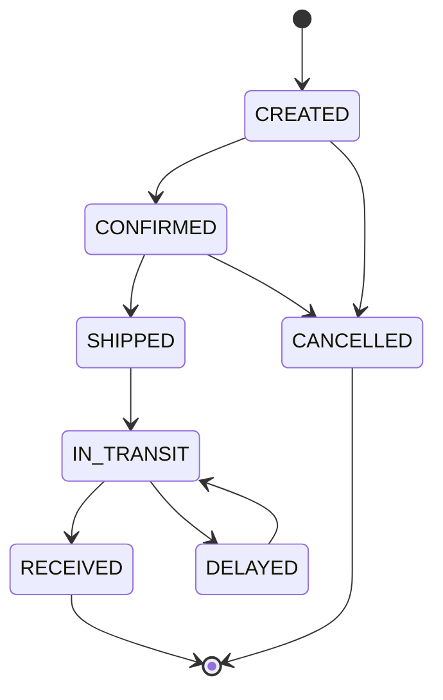
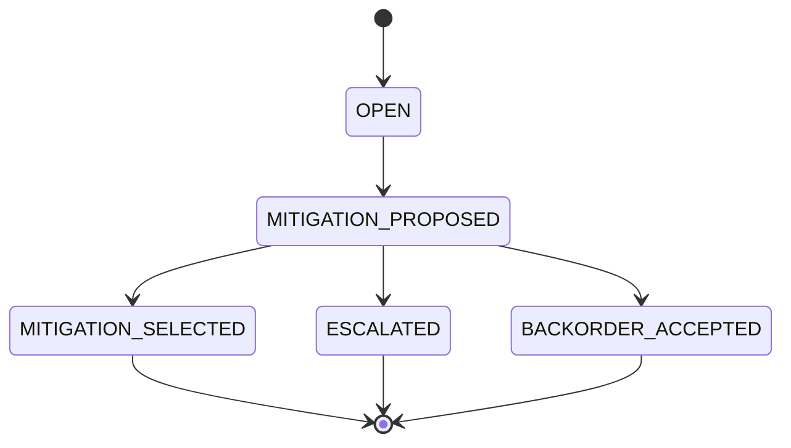
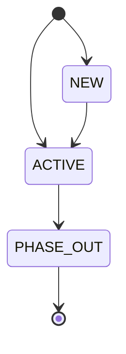
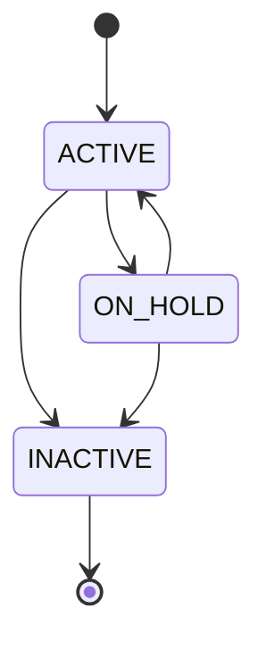
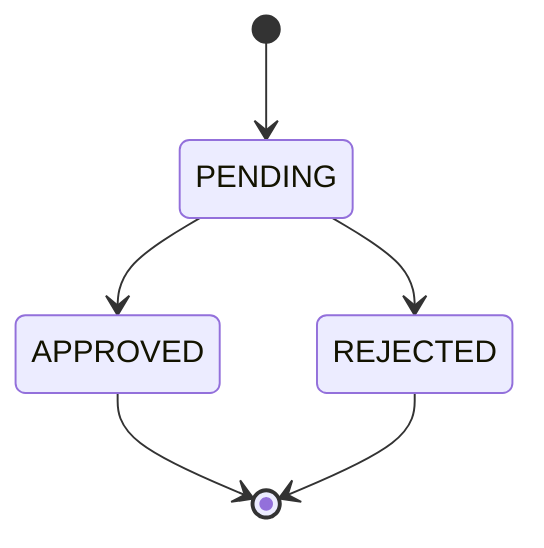

# Entity-relationship diagram

Generated by `python -m planner docs` from `src/planner/schema.py` — do not edit by hand.

Composite FKs to `sku_location` (the assortment bridge) are drawn once per child; they guarantee that demand, inventory, POs, production, PAB and shortages only exist for stocked SKU-locations.

```mermaid
erDiagram
    SKU ||--o{ SKU_LOCATION : "stocked as"
    LOCATION ||--o{ SKU_LOCATION : "stocks"
    SUPPLIER ||--o{ SUPPLIER_SKU : "sells"
    SKU ||--o{ SUPPLIER_SKU : "sourced via"
    SKU ||--o{ SKU_SUBSTITUTE : "can be replaced via"
    SKU ||--o{ SKU_SUBSTITUTE : "substitutes in"
    SKU ||--o{ BOM : "is made from"
    SKU ||--o{ BOM : "is used in"
    SUPPLIER ||--o{ LEAD_TIME : "ships via"
    SUPPLIER ||--o{ SUPPLIER_CAPACITY : "has"
    LOCATION ||--o{ PRODUCTION_CAPACITY : "has"
    SKU ||--o{ FORECAST_DEMAND : "forecast for"
    LOCATION ||--o{ FORECAST_DEMAND : "forecast at"
    SKU_LOCATION ||--o{ FORECAST_DEMAND : "demand of"
    SUPPLIER ||--o{ PURCHASE_ORDER : "receives"
    SKU ||--o{ PURCHASE_ORDER : "ordered on"
    LOCATION ||--o{ PURCHASE_ORDER : "ships to"
    SUPPLIER_SKU ||--o{ PURCHASE_ORDER : "orders under"
    LEAD_TIME ||--o{ PURCHASE_ORDER : "planned on"
    SKU_LOCATION ||--o{ PURCHASE_ORDER : "replenishes"
    PURCHASE_ORDER ||--o{ PURCHASE_ORDER_EVENT : "has history"
    SKU ||--o{ INVENTORY_TXN : "moves"
    LOCATION ||--o{ INVENTORY_TXN : "records"
    SKU_LOCATION ||--o{ INVENTORY_TXN : "ledger of"
    PURCHASE_ORDER |o--o{ INVENTORY_TXN : "received as"
    SKU ||--o{ INVENTORY : "held as"
    LOCATION ||--o{ INVENTORY : "holds"
    SKU_LOCATION ||--o{ INVENTORY : "snapshot of"
    PURCHASE_ORDER |o--o| INVENTORY : "in transit as"
    SKU ||--o{ PRODUCTION_PLAN : "produced as"
    LOCATION ||--o{ PRODUCTION_PLAN : "produces"
    SKU_LOCATION ||--o{ PRODUCTION_PLAN : "supplies"
    SUPPLIER ||--o{ PLANNED_ORDER : "planned with"
    SKU ||--o{ PLANNED_ORDER : "planned for"
    LOCATION ||--o{ PLANNED_ORDER : "planned to"
    SUPPLIER_SKU ||--o{ PLANNED_ORDER : "planned under"
    LEAD_TIME ||--o{ PLANNED_ORDER : "planned on"
    SUPPLIER_CAPACITY ||--o{ PLANNED_ORDER : "consumes"
    SKU_LOCATION ||--o{ PLANNED_ORDER : "replenishes"
    SKU ||--o{ PROJECTED_BALANCE : "projected for"
    LOCATION ||--o{ PROJECTED_BALANCE : "projected at"
    SKU_LOCATION ||--o{ PROJECTED_BALANCE : "projection of"
    SKU ||--o{ SHORTAGE : "short on"
    LOCATION ||--o{ SHORTAGE : "short at"
    SKU_LOCATION ||--o{ SHORTAGE : "shortage of"
    SHORTAGE ||--o{ SHORTAGE_CAUSE : "explained by"
    SHORTAGE ||--o{ MITIGATION_OPTION : "mitigated by"
    PURCHASE_ORDER |o--o{ MITIGATION_OPTION : "expedited by"
    SUPPLIER |o--o{ MITIGATION_OPTION : "alternate for"
    LEAD_TIME |o--o{ MITIGATION_OPTION : "lane for"
    LOCATION |o--o{ MITIGATION_OPTION : "transfers from"
    SKU_SUBSTITUTE |o--o{ MITIGATION_OPTION : "applied in"
    SKU |o--o{ MITIGATION_OPTION : "substitutes in"
    LOCATION |o--o{ MITIGATION_OPTION : "produces for"
    SHORTAGE ||--o{ SHORTAGE_EVENT : "has history"
    MITIGATION_OPTION |o--o{ SHORTAGE_EVENT : "selected in"

    LOCATION {
        string location_id PK
        string location_name
        string location_type
        string city
        string region
        bool is_active
        date effective_from
    }
    SKU {
        string sku_id PK
        string sku_name
        string category
        string sku_type
        string sourcing_type
        string base_uom
        int case_pack_qty
        decimal unit_cost_inr
        decimal unit_price_inr
        string abc_class
        string criticality
        string lifecycle_state
        date effective_from
        date effective_to
        int safety_stock_weeks
    }
    SUPPLIER {
        string supplier_id PK
        string supplier_name
        string home_region
        string status
        decimal on_time_rate
        date effective_from
        date effective_to
    }
    SKU_LOCATION {
        string sku_id PK, FK
        string location_id PK, FK
        int safety_stock_qty
        bool is_active
        date effective_from
    }
    SUPPLIER_SKU {
        string supplier_sku_id PK
        string supplier_id FK, UK
        string sku_id FK, UK
        bool is_primary
        string approval_status
        decimal unit_cost_inr
        string purchase_uom
        int uom_conversion
        int moq
        int order_multiple
        date effective_from UK
        date effective_to
    }
    SKU_SUBSTITUTE {
        string substitute_id PK
        string sku_id FK, UK
        string substitute_sku_id FK, UK
        string approval_status
        decimal substitution_ratio
        decimal price_delta_pct
        date effective_from
        date effective_to
    }
    BOM {
        string bom_id PK
        string parent_sku_id FK, UK
        string component_sku_id FK, UK
        int qty_per
        string uom
        date effective_from UK
        date effective_to
    }
    LEAD_TIME {
        string lead_time_id PK
        string supplier_id FK, UK
        string dest_region UK
        string transport_mode
        bool is_expedite_lane UK
        int production_days
        int transit_days
        int total_lead_weeks
        date effective_from UK
        date effective_to
    }
    SUPPLIER_CAPACITY {
        string capacity_id PK
        string supplier_id FK, UK
        string week UK
        int capacity_qty_ea
    }
    PRODUCTION_CAPACITY {
        string plant_location_id PK, FK
        string week PK
        int capacity_qty_ea
    }
    FORECAST_DEMAND {
        string demand_id PK
        string sku_id FK, UK
        string location_id FK, UK
        string week UK
        date week_start_date
        int baseline_qty_ea
        int forecast_qty_ea
        string demand_driver
    }
    PURCHASE_ORDER {
        string po_id PK
        string supplier_id FK
        string sku_id FK
        string ship_to_location_id FK
        string supplier_sku_id FK
        string lead_time_id FK
        date order_date
        int order_qty
        string order_uom
        int uom_conversion
        int qty_base_ea
        string expected_receipt_week
        int delay_weeks
        string revised_receipt_week
        string status
        string created_by_role
    }
    PURCHASE_ORDER_EVENT {
        string event_id PK
        string po_id FK, UK
        int seq UK
        string from_status
        string to_status
        datetime event_ts
        string actor_role
        string reason_code
    }
    INVENTORY_TXN {
        string txn_id PK
        string sku_id FK
        string location_id FK
        string txn_type
        int qty_ea
        date txn_date
        string ref_id FK
    }
    INVENTORY {
        string inventory_id PK
        string sku_id FK
        string location_id FK
        string inventory_status
        int qty_ea
        date as_of_date
        string po_id FK
    }
    PRODUCTION_PLAN {
        string prod_plan_id PK
        string sku_id FK, UK
        string plant_location_id FK, UK
        string week UK
        int planned_qty_ea
        string status
        int capacity_used_ea
        int requested_qty_ea
        int component_cut_ea
    }
    EXCEPTION {
        string exception_id PK
        string issue_type
        string entity
        string record_id
        string related_record_ids
        string detection_rule
        string action_taken
        string severity
        string detail
    }
    PLANNED_ORDER {
        string planned_order_id PK
        string supplier_id FK
        string sku_id FK
        string location_id FK
        string supplier_sku_id FK
        string lead_time_id FK
        string capacity_id FK
        string release_week
        string receipt_week
        int order_qty
        string order_uom
        int qty_base_ea
        int requested_qty_ea
        int capacity_cut_ea
    }
    PROJECTED_BALANCE {
        string sku_id PK, FK
        string location_id PK, FK
        string week PK
        int opening_qty
        int firm_receipts
        int planned_receipts
        int production_receipts
        int demand_qty
        int closing_qty
        int safety_stock_qty
        string balance_status
    }
    SHORTAGE {
        string shortage_id PK
        string sku_id FK, UK
        string location_id FK, UK
        string start_week UK
        string end_week
        string peak_week
        string shortage_type
        int shortage_qty_ea
        int below_ss_qty_ea
        decimal value_at_risk_inr
        string primary_cause
        string explanation
        decimal priority_score
        int priority_rank
        string status
    }
    SHORTAGE_CAUSE {
        string shortage_id PK, FK
        string cause_code PK
        string evidence_type
        string evidence_id PK
        int contribution_qty_ea
    }
    MITIGATION_OPTION {
        string mitigation_id PK
        string shortage_id FK, UK
        int option_seq UK
        string option_type
        string source
        string created_by_role
        string ref_po_id FK
        string ref_supplier_id FK
        string ref_lead_time_id FK
        string ref_from_location_id FK
        string ref_substitute_id FK
        string ref_substitute_sku_id FK
        string ref_plant_location_id FK
        int qty_covered_ea
        decimal coverage_pct
        string arrival_week
        int weeks_late
        decimal incremental_cost_inr
        decimal fill_rate_after
        decimal score
        string policy_status
        string policy_violation_reason
        bool requires_approval
        bool is_recommended
    }
    SHORTAGE_EVENT {
        string event_id PK
        string shortage_id FK, UK
        int seq UK
        string from_status
        string to_status
        datetime event_ts
        string actor_role
        string reason_code
        string mitigation_id FK
    }
    GROUND_TRUTH {
        string gt_id PK
        string case_class
        string issue_type
        string entity
        string record_id
        string related_record_ids
        string injection_rule
        string expected_detection_rule
        string expected_action
        string expected_outcome
    }
```

## Cardinality

Parent : child. `optional` = the FK column may be empty (child need not reference a parent). Every parent may have zero children unless noted.

| Parent | Child | Via (child columns) | Cardinality | Optional |
|---|---|---|---|---|
| `sku` | `sku_location` | `sku_id` | 1:N | no |
| `location` | `sku_location` | `location_id` | 1:N | no |
| `supplier` | `supplier_sku` | `supplier_id` | 1:N | no |
| `sku` | `supplier_sku` | `sku_id` | 1:N | no |
| `sku` | `sku_substitute` | `sku_id` | 1:N | no |
| `sku` | `sku_substitute` | `substitute_sku_id` | 1:N | no |
| `sku` | `bom` | `parent_sku_id` | 1:N | no |
| `sku` | `bom` | `component_sku_id` | 1:N | no |
| `supplier` | `lead_time` | `supplier_id` | 1:N | no |
| `supplier` | `supplier_capacity` | `supplier_id` | 1:N | no |
| `location` | `production_capacity` | `plant_location_id` | 1:N | no |
| `sku` | `forecast_demand` | `sku_id` | 1:N | no |
| `location` | `forecast_demand` | `location_id` | 1:N | no |
| `sku_location` | `forecast_demand` | `sku_id, location_id` | 1:N | no |
| `supplier` | `purchase_order` | `supplier_id` | 1:N | no |
| `sku` | `purchase_order` | `sku_id` | 1:N | no |
| `location` | `purchase_order` | `ship_to_location_id` | 1:N | no |
| `supplier_sku` | `purchase_order` | `supplier_sku_id` | 1:N | no |
| `lead_time` | `purchase_order` | `lead_time_id` | 1:N | no |
| `sku_location` | `purchase_order` | `sku_id, ship_to_location_id` | 1:N | no |
| `purchase_order` | `purchase_order_event` | `po_id` | 1:N | no |
| `sku` | `inventory_txn` | `sku_id` | 1:N | no |
| `location` | `inventory_txn` | `location_id` | 1:N | no |
| `sku_location` | `inventory_txn` | `sku_id, location_id` | 1:N | no |
| `purchase_order` | `inventory_txn` | `ref_id` | 1:N | yes |
| `sku` | `inventory` | `sku_id` | 1:N | no |
| `location` | `inventory` | `location_id` | 1:N | no |
| `sku_location` | `inventory` | `sku_id, location_id` | 1:N | no |
| `purchase_order` | `inventory` | `po_id` | 1:0..1 | yes |
| `sku` | `production_plan` | `sku_id` | 1:N | no |
| `location` | `production_plan` | `plant_location_id` | 1:N | no |
| `sku_location` | `production_plan` | `sku_id, plant_location_id` | 1:N | no |
| `supplier` | `planned_order` | `supplier_id` | 1:N | no |
| `sku` | `planned_order` | `sku_id` | 1:N | no |
| `location` | `planned_order` | `location_id` | 1:N | no |
| `supplier_sku` | `planned_order` | `supplier_sku_id` | 1:N | no |
| `lead_time` | `planned_order` | `lead_time_id` | 1:N | no |
| `supplier_capacity` | `planned_order` | `capacity_id` | 1:N | no |
| `sku_location` | `planned_order` | `sku_id, location_id` | 1:N | no |
| `sku` | `projected_balance` | `sku_id` | 1:N | no |
| `location` | `projected_balance` | `location_id` | 1:N | no |
| `sku_location` | `projected_balance` | `sku_id, location_id` | 1:N | no |
| `sku` | `shortage` | `sku_id` | 1:N | no |
| `location` | `shortage` | `location_id` | 1:N | no |
| `sku_location` | `shortage` | `sku_id, location_id` | 1:N | no |
| `shortage` | `shortage_cause` | `shortage_id` | 1:N | no |
| `shortage` | `mitigation_option` | `shortage_id` | 1:N | no |
| `purchase_order` | `mitigation_option` | `ref_po_id` | 1:N | yes |
| `supplier` | `mitigation_option` | `ref_supplier_id` | 1:N | yes |
| `lead_time` | `mitigation_option` | `ref_lead_time_id` | 1:N | yes |
| `location` | `mitigation_option` | `ref_from_location_id` | 1:N | yes |
| `sku_substitute` | `mitigation_option` | `ref_substitute_id` | 1:N | yes |
| `sku` | `mitigation_option` | `ref_substitute_sku_id` | 1:N | yes |
| `location` | `mitigation_option` | `ref_plant_location_id` | 1:N | yes |
| `shortage` | `shortage_event` | `shortage_id` | 1:N | no |
| `mitigation_option` | `shortage_event` | `mitigation_id` | 1:N | yes |

### Many-to-many relationships (bridge tables)

| Entity A | Entity B | Bridge table | Cardinality | Meaning |
|---|---|---|---|---|
| `sku` | `location` | `sku_location` | N:M | Assortment: a SKU is stocked at many locations; a location stocks many SKUs. |
| `supplier` | `sku` | `supplier_sku` | N:M | Sourcing: a SKU has 1 primary + 0-2 alternate suppliers; a supplier sells many SKUs. |
| `sku` | `sku` | `sku_substitute` | N:M | Substitution: a SKU may have several substitutes and substitute for several SKUs. |
| `sku` | `sku` | `bom` | N:M | BOM: a MAKE SKU uses 2-4 components; a component is used in many parents. |
| `shortage` | `evidence records` | `shortage_cause` | N:M | Causes: a shortage has many causes; an evidence record can explain many shortages. |

### One-to-one relationships

| Entity A | Entity B | Rule |
|---|---|---|
| `purchase_order` (shipped, open) | `inventory` (IN_TRANSIT row) | 1:0..1 — at most one IN_TRANSIT row per PO; a second row is the DUPLICATE_INBOUND anomaly. |
| `shortage` | `mitigation_option` (is_recommended) | 1:0..1 — at most one recommended option per shortage. |

### Polymorphic references

These columns point at different tables depending on a type column, so they are validated in code instead of by an SQL FK.

| Table.column | Type column | Targets |
|---|---|---|
| `shortage_cause.evidence_id` | `evidence_type` | `forecast_demand`, `purchase_order`, `planned_order`, `supplier_capacity`, `lead_time`, `inventory`, `production_plan`, `bom` |
| `exception.record_id` | `entity` | `inventory`, `purchase_order`, `mitigation_option` |
| `ground_truth.record_id` | `entity` | any input table |

## Effective-dated entities

| Table | Columns |
|---|---|
| `location` | `effective_from` |
| `sku` | `effective_from`, `effective_to` |
| `supplier` | `effective_from`, `effective_to` |
| `sku_location` | `effective_from` |
| `supplier_sku` | `effective_from`, `effective_to` |
| `sku_substitute` | `effective_from`, `effective_to` |
| `bom` | `effective_from`, `effective_to` |
| `lead_time` | `effective_from`, `effective_to` |

## Lifecycle state machines

### purchase_order (`purchase_order`)

Every PO starts CREATED. purchase_order.status = last event's to_status. No event after as-of.

History is kept append-only in `purchase_order_event`.

| From | To |
|---|---|
| (start) | `CREATED` |
| `CREATED` | `CONFIRMED` |
| `CONFIRMED` | `SHIPPED` |
| `SHIPPED` | `IN_TRANSIT` |
| `IN_TRANSIT` | `RECEIVED` |
| `IN_TRANSIT` | `DELAYED` |
| `DELAYED` | `IN_TRANSIT` |
| `CREATED` | `CANCELLED` |
| `CONFIRMED` | `CANCELLED` |

### shortage (`shortage`)

ESCALATED when the best compliant option needs OPERATIONS_MANAGER approval; BACKORDER_ACCEPTED when no feasible non-backorder option exists.

History is kept append-only in `shortage_event`.

| From | To |
|---|---|
| (start) | `OPEN` |
| `OPEN` | `MITIGATION_PROPOSED` |
| `MITIGATION_PROPOSED` | `MITIGATION_SELECTED` |
| `MITIGATION_PROPOSED` | `ESCALATED` |
| `MITIGATION_PROPOSED` | `BACKORDER_ACCEPTED` |

### sku_lifecycle (`sku`)

Snapshot state at the as-of date (master data, no event table). PHASE_OUT SKUs carry effective_to.

| From | To |
|---|---|
| (start) | `NEW` |
| (start) | `ACTIVE` |
| `NEW` | `ACTIVE` |
| `ACTIVE` | `PHASE_OUT` |

### supplier_status (`supplier`)

Snapshot status at the as-of date. Only ACTIVE suppliers may be used for new orders.

| From | To |
|---|---|
| (start) | `ACTIVE` |
| `ACTIVE` | `ON_HOLD` |
| `ON_HOLD` | `ACTIVE` |
| `ACTIVE` | `INACTIVE` |
| `ON_HOLD` | `INACTIVE` |

### approval (`supplier_sku / sku_substitute`)

Approval of sourcing lines and substitutes. Only APPROVED and effective records may be used.

| From | To |
|---|---|
| (start) | `PENDING` |
| `PENDING` | `APPROVED` |
| `PENDING` | `REJECTED` |
