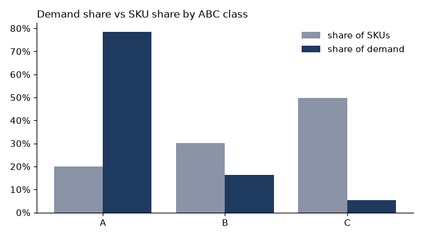
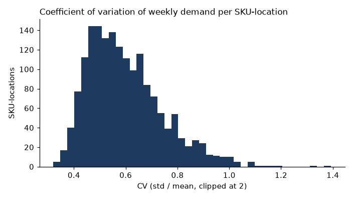
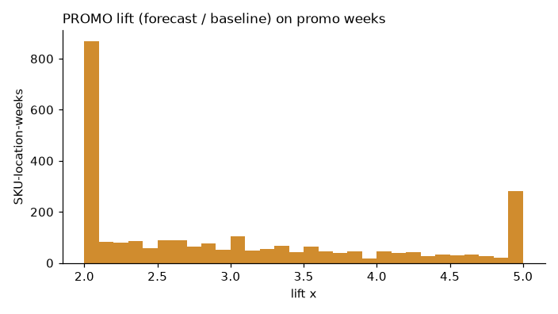
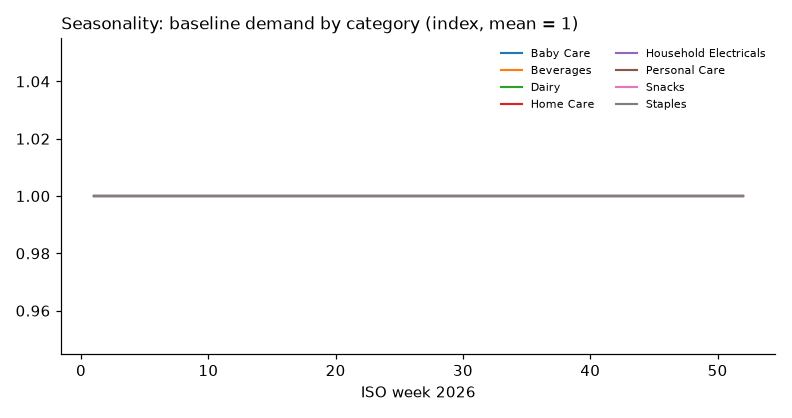
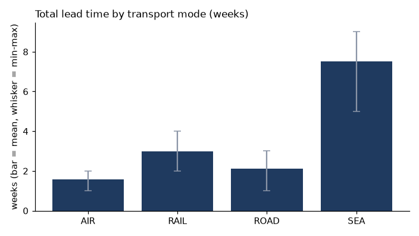
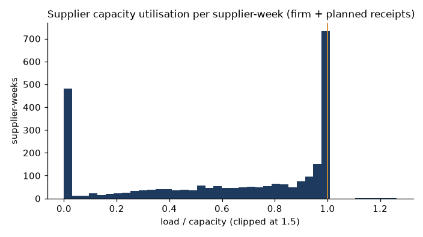
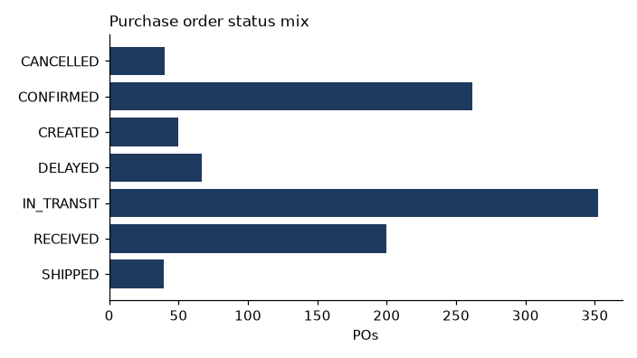

# Data profile — scale `starter`, seed 20261022

Generated by `python -m planner export` from the written input tables (after injection).

## Demand

Forecast rows: 89,544.

| abc_class | skus | demand_ea | sku_share | demand_share |
|---|---|---|---|---|
| A | 51 | 7,347,107 | 20.0% | 78.4% |
| B | 77 | 1,534,127 | 30.2% | 16.4% |
| C | 127 | 494,863 | 49.8% | 5.3% |

- CV of weekly demand per SKU-location: p10 0.44, median 0.57, p90 0.79
- Demand driver mix: BASELINE 77.95%, PROMO 2.96%, SEASONAL_PEAK 19.09%
- PROMO spike rate 2.96% of SKU-location-weeks; lift median 2.67x (range 2.00-10.82x)

## Supply

| transport_mode | count | min | 50% | mean | max |
|---|---|---|---|---|---|
| AIR | 250 | 1 | 2 | 1.57 | 2 |
| RAIL | 120 | 2 | 3 | 2.98 | 4 |
| ROAD | 95 | 1 | 2 | 2.12 | 3 |
| SEA | 48 | 5 | 8 | 7.52 | 9 |

- Supplier capacity utilisation (firm + planned receipts / capacity) per supplier-week: median 75.3%, p90 100.0%, weeks at or above capacity 7.3% (injected overloads + MRP filling capacity)
- Transport delay rate (non-cancelled POs with delay_weeks > 0): 8.25%; delay weeks: 0 wk 930, 1 wk 27, 2 wk 28, 3 wk 25
- PO status mix: CANCELLED 40 (4.0%), CONFIRMED 262 (25.9%), CREATED 50 (5.0%), DELAYED 67 (6.6%), IN_TRANSIT 352 (34.9%), RECEIVED 200 (19.8%), SHIPPED 39 (3.9%)

## Figures

