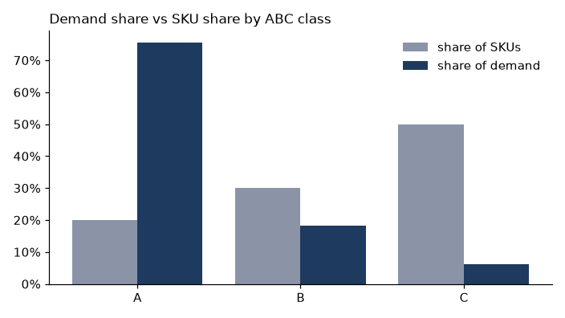
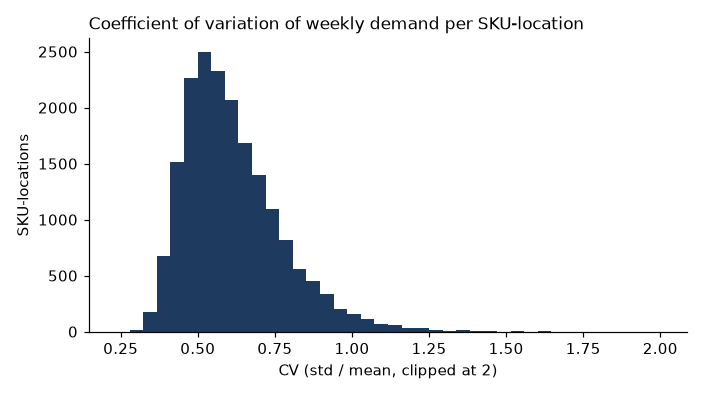
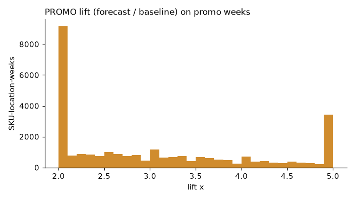
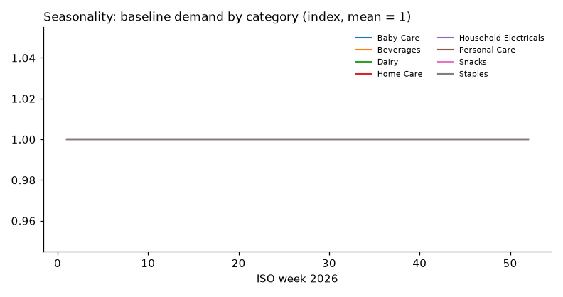
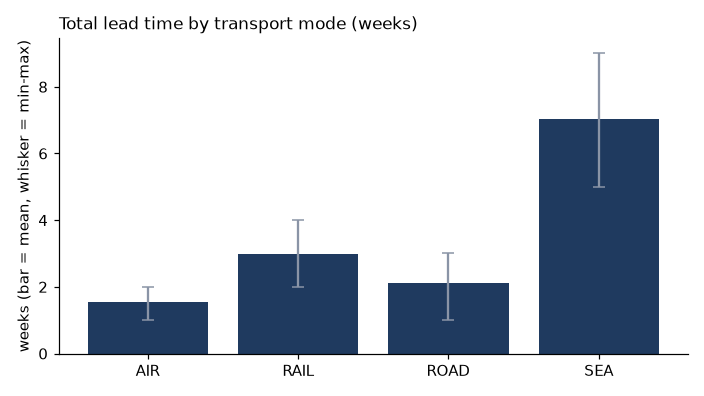
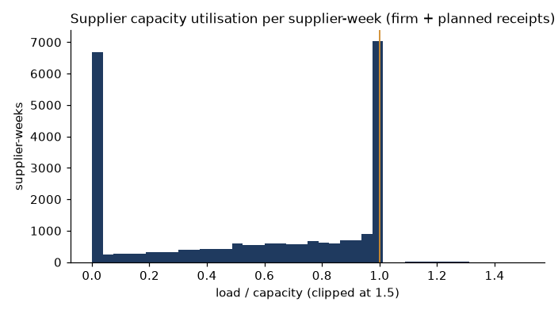
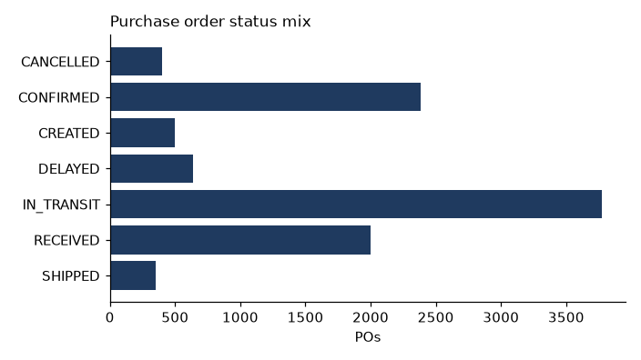

# Data profile — scale `full`, seed 20261022

Generated by `python -m planner export` from the written input tables (after injection).

## Demand

Forecast rows: 966,524.

| abc_class | skus | demand_ea | sku_share | demand_share |
|---|---|---|---|---|
| A | 510 | 55,275,877 | 20.0% | 75.4% |
| B | 765 | 13,438,981 | 30.0% | 18.3% |
| C | 1,275 | 4,564,196 | 50.0% | 6.2% |

- CV of weekly demand per SKU-location: p10 0.44, median 0.58, p90 0.82
- Demand driver mix: BASELINE 77.60%, PROMO 3.02%, SEASONAL_PEAK 19.37%
- PROMO spike rate 3.02% of SKU-location-weeks; lift median 2.74x (range 2.00-15.00x)

## Supply

| transport_mode | count | min | 50% | mean | max |
|---|---|---|---|---|---|
| AIR | 2,500 | 1 | 2 | 1.54 | 2 |
| RAIL | 1,145 | 2 | 3 | 2.98 | 4 |
| ROAD | 1,072 | 1 | 2 | 2.12 | 3 |
| SEA | 422 | 5 | 7 | 7.05 | 9 |

- Supplier capacity utilisation (firm + planned receipts / capacity) per supplier-week: median 63.6%, p90 100.0%, weeks at or above capacity 15.0% (injected overloads + MRP filling capacity)
- Transport delay rate (non-cancelled POs with delay_weeks > 0): 8.30%; delay weeks: 0 wk 9,240, 1 wk 263, 2 wk 257, 3 wk 280
- PO status mix: CANCELLED 400 (4.0%), CONFIRMED 2,385 (23.8%), CREATED 495 (4.9%), DELAYED 640 (6.4%), IN_TRANSIT 3,770 (37.5%), RECEIVED 2,000 (19.9%), SHIPPED 350 (3.5%)

## Figures

